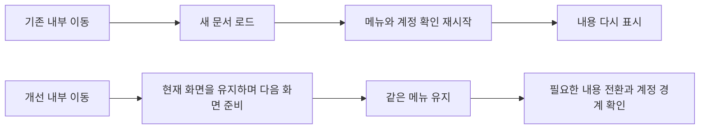

# 화면 전환의 구조 분석과 안정화 — 2026-10-14

주요 이동이 조용하지 않았던 원인은 CSS보다 **내부 이동을 전체 문서 이동으로 강제하고, 상단 메뉴까지 페이지마다 다시 만드는 구조**였다. 기존 Astro 전환 기능을 사용하고 공통 메뉴를 유지하도록 수정했다. 실제 빌드에서 작품→기억→컬렉션의 추가 문서 이동은3회에서0회로 줄었고, 같은 상단 메뉴 DOM이 유지됐다. 페이지 내용의 계정 확인과 데이터 읽기는 계속 수행한다.

## 1. 읽은 근거와 확인 범위

상위 AGENTS/THIS_PC_HANDOFF, 저장소 AGENTS/START/확정 결정/PLANS, 기존 W18 계획·계약·단일 작업판, BaseLayout·메뉴·검색·MemoryRouteShell·owner/auth/account hooks·프로그램 이동·편집 보호·이력·해당 검사를 대조했다. 기준은 `7e8bd78e32217cf388bae3c31bf2438b7f2934fc`다.

설치된 Astro **5.17.2**의 router/events/swap source와 [공식 전환 문서](https://docs.astro.build/en/guides/view-transitions/), [Astro5 안내](https://docs.astro.build/en/guides/upgrade-to/v5/)를 교차 확인했다. 사용자의 Are.na/Pinterest 비교는 화면 전환 체감의 기준으로 사용했으며, 두 서비스의 내부 코드·라우터·데이터 캐시를 확인했다고 주장하지 않는다.

## 2. 구조적 원인과 구분

| 실제 원인 | 검증 근거 | 처리 |
| --- | --- | --- |
| 내부 링크의 강제 문서 이동 | 기존 ClientRouter가 있으나 `data-astro-reload`50개/25파일이 있고 주요 메뉴에도 적용. 별도 빈 브라우저에서 주요3회 이동 모두 window marker와 메뉴가 교체됨 | 활성 내부 링크의40개 제거. 미사용 옛 Home4개 컴포넌트의9개와 가입 안내의 의도적 문서 이동1개는 유지 |
| 버튼·검색도 문서 이동 | 계정 메뉴·검색·보드 생성/삭제·카드 삭제/보관함 이동·옛 주소가 assign/replace를 직접 사용 | Web은 공통 이동 함수, Native는 기존 packaged index, OAuth/가입/외부는 문서 이동을 유지 |
| 메뉴가 각 React 페이지 root의 일부 | MemoryRouteShell/Library/Tier/Data/Help/Profile마다 메뉴를 만들며 페이지들은 client-only. 이동 때 auth/account/menu 초기화가 반복 | 메뉴를 별도 persisted island로 유지. 경로 props만 갱신하고 페이지 쪽 기존 메뉴 호출은 호환 adapter에서 중복 렌더를 생략 |
| 같은 주소도 내용 재마운트 | 활성 메뉴를 눌러도 다시 이동. 강제 reload 제거만 하면 같은 주소의 brand 링크도 dirty editor를 재생성할 수 있음 | 동일 주소의 정상 왼쪽 클릭은 no-op. 수정키·새 창·다운로드와 다른 주소는 원래 의미 유지. 실제 brand/본문 제목 링크의 draft 보존 검사 |
| 편집 보호가 문서 unload에 의존 | 기존 링크 capture/beforeunload는 있지만 soft 프로그램/Back은 다른 경로. Astro5 preparation 취소는 hard fallback임을 실제 코드로 확인 | 링크 guard 유지, 프로그램 이동은 별도 cancelable intent, Back 취소는 같은 history entry로 복귀. busy 이동 차단 유지 |
| 로컬 URL 변경이 router state를 삭제 | Collection/Archive/public 그룹이 replaceState(null) 사용 | 현재 history state를 보존해 back/forward·scroll metadata 유지 |
| 페이지 전체 fade와 준비 중 재편집 | 기본 전환의 root fade, 다음 화면을 준비하는 동안 현재 내용에서 새 draft를 시작할 수 있음 | root 전환 애니메이션 제거/지원 없는 브라우저는 swap. 현재 화면을 유지하면서 내용 영역만 inert/busy, 메뉴는 다음 목적지 선택 가능. 새 목적지가 늦은 요청을 취소하는 실제 검사 |
| 메뉴·내용의 별도 locale/theme 상태 | 메뉴를 분리하면 기존 독립 useStoredState가 같은 창의 다른 root에 전달되지 않음 | 기존 값/키를 유지하며 UI preference 변경을 같은 창의 root에 전달. swap 때 boot script 재실행. 실제 KO/dark 유지 및 EN 변경이 내용에도 반영됨 |

모든 버튼이 전체 새로고침을 일으킨 것은 아니다. 기존 TaskSections의 패널 유지, 그리드/표·정렬/선택의 React 상태 변경은 이미 부분 변경이므로 유지했다. 페이지별 owner 확인·읽기와 실제 저장/게시 동작을 ‘깜빡임 제거’ 때문에 생략하지 않았다.

## 3. 계획·구조·가정

계획은 release-v2/01의 **W18 내부 이동·화면 재구성 안정화 ExecPlan — 2026-10-14**, 상태 기준은 단일03이다. 새 프레임워크·라우터·전역 private 캐시를 도입하지 않았다.

Astro는 다음 HTML을 준비하고 내용 root를 바꾼다. React 페이지를 통째로 영구 보관하는 방식은 아니다. 메뉴의 계정/테마/PWA 상태는 유지하되 검색은 경로·계정·준비 상태별로 새 scope를 사용한다. 계정 확인 중에는 이전 검색 결과를 보여주지 않는다. 기존 public home/board에는 새 소유자 메뉴를 추가하지 않았다.

## 4. 변경 파일과 목적

| 소스 | 목적·행 근거 |
| --- | --- |
| `src/layouts/BaseLayout.astro:47–59,81–112` | Router head 배치, fade 제거, preference/auth return script 재실행, 메뉴 island 유지, 내용 wrapper·같은 주소 클릭·준비 lifecycle |
| `src/components/WebNavigation.jsx:5–17` | 공통 메뉴의 preference/PWA 상태와 현재 경로 props |
| `src/components/TopNavDataMenu.jsx:101–135,162–165,213–216` | 호환 중복 방지, 준비 중/다른 계정의 검색 배제, 메뉴 닫기, 계정 이동 |
| `src/components/PrimaryNavigationLinks.jsx:17–23` | 내부 soft 이동과 같은 주소 no-op |
| `src/domain/appRoutes.js`, `src/domain/appNavigation.js`, `src/lib/appNavigation.js` | 알려진 앱 경로·subpath/Native/외부·가입 구분, 의도 확인 후 이동, 안전한 protocol/URL/이력 처리 |
| `src/lib/navigationLifecycle.js:1–23` | 요청 준비 중 현재 내용 유지·새 편집 방지, 완료/취소 때 해제와 listener cleanup |
| `src/hooks/useUnsavedNavigation.js:7–65` | 기존 보호에 프로그램 intent·soft Back 취소/복귀 추가 |
| `src/hooks/useUiPreferences.js:20–61` | 분리된 메뉴와 내용의 언어/테마 전달, 동일 저장 형식 유지 |
| `TopNavGlobalSearch`, `FirstMemoryViewSuggestion`, `LegacyLibraryRoute`, `CollectionLegacyRedirect`, `MemoryBoardView`, `MemoryCardDetail`, `useMemoryCardComposer` | 실제 버튼/검색/옛 링크/저장 뒤 이동을 공통 경로에 연결 |
| 기존 title/card/sharing 내부 링크와 Collection/Archive/MinihomeSnapshot | 강제 reload만 제거, URL 변경 때 history 보존. 기존 데이터·권리·저장 컨트롤러는 그대로 |

검사는 `navigation-stability.spec.ts`7개와 `unit/appRoutes.test.mjs`4개를 추가하고 기존 accountMenu의 위임 지점 검사1개를 새 공통 함수에 맞췄다. Web/Native·취소·잘못된 protocol·외부의 실제 분기를 별도로 검사한다. quality workflow의 기존 격리 컬렉션 단계에 새 navigation 파일을 넣었다. 부모 페이지의 기존 메뉴 props는 호환 adapter로 보존해 큰 페이지들을 불필요하게 재작성하지 않았다.

## 5. 데이터·마이그레이션·복귀

DB/Storage/API/auth repository/계정 초기화 엔진/권리·고지·공개 controller/환경·flags·운영 변경 **0**. 새 의존성·lock 변경 **0**. 기존 source ID·공개 URL·로컬 원본·동의·버전/hash를 보존했다.

이번 UI/navigation patch를 revert하면7e8bd78 동작으로 복귀한다. 데이터 복원·마이그레이션 재적용은 필요 없다. 작업 시작 때 설치 위치 오류로 main의 npm ci가 실행 중 DLL 잠금에 실패했다. 이 세션의 dev process만 확인·종료하고 불완전 node_modules를 검증된 `.tools/preserved-main-dependencies-20261014-navigation`에 보존, 같은 lock으로 새 설치를 완료했다. main 소스/lock clean·4363 HTTP200/기준 전후 측정의 JS 오류0을 재확인했다. 리뷰 checkout은 별도 deps/cache로 검증했다.

## 6. 실제 검증

| 검사 | 실제 결과·근거 |
| --- | --- |
| 기준의 동작 재현 | 올바른 selector로 실행한 primary/same-address/account 버튼3개 FAIL, 실제 marker 교체가 원인. 최초 잘못된 selector 실행은 증거로 합산하지 않음. `navigation-reproduced-valid.log` |
| 전후 주요 이동 | 기준7e8bd78의 작품→기억→컬렉션3회 모두 추가 main-frame 문서 이동/메뉴 재생성. 개선 built static에서는3회 모두 같은 문서·메뉴, 추가 문서 이동0. DEV의 숨은 준비 iframe은 main-frame 이동과 분리 |
| 기존 내용·편집·경로 | navigation6 + collection12 + shelves2 + titles7 + editing11 + title navigation5 = **43 PASS**. `navigation-ui-check.log` |
| 공개·계정 경계·디자인 | publication54 + owner boundary3 + arena8 = **65 PASS**. `navigation-public-owner-check.log` |
| 계정 메뉴 | 기존8 + navigation6 =14 PASS, 실제 mock fixture에 맞는 SDK 없는 환경. `navigation-account-final.log`. 잘못 선택한 dummy SDK 환경의2개 실패는 기존7e8bd78에서도 동일 재현했고 제품 오류로 바꾸지 않음 |
| 마지막 편집/준비 상태 | navigation7 + editing11 = **18 PASS**, 준비 중 inert/해제·더 새 목적지·brand의 draft 보존 포함. `navigation-guard-final.log` |
| 고유 브라우저 범위 | 위 중복 실행을 제외한 **117개 고유 시나리오**. 실제 hosted Google/물리기기 전체 검증 수치가 아님 |
| 단위 | **630 PASS / 실패0 / skip0**. 경로/위임의 새4개와 기존 Native·계정·공개·원본 계약 포함. `navigation-unit-final.log` |
| 빌드/실제 산출물 | **33페이지 build/postbuild PASS**. 같은 빌드의 Chromium에서3개 주요 메뉴·Back/Forward·계정 버튼·320/390/1440·메뉴 유지·문서 이동0·JS 예외0 확인. hosted 운영 결과와 구분 |
| React Doctor | 같은 캐시0.9.11의 source 범위 **34→34 / 기존533개**, 신규 rule/file0. 최종 changed 검사0진단. 기존 정적370/전체 진단을 해결했다고 주장하지 않음. 최신CLI의 repo 설치 요구 때문에 새 dependency를 넣지 않았다 |

로그는 이 PC `.tools/navigation-*.log`와 `.tools/navigation-comparison-20261014/`에 있다. 최초 static helper는 root 경계 검사로 `/`를404 처리해 실패했으며 helper를 교정한 뒤 실제 산출물 확인을 완료했다. 새 source 후 검증 서버가 준비 전 끝난 실행도 성공에 합산하지 않았다. 준비 시간 allowance만 보완했으며 test assertions·재시도 설정은 완화하지 않았다.

## 7. 개인정보·권리·관측과 비교 자료

저장된 private 페이지/DTO/사진을 전역에 캐시하거나 owner ready/key를 우회하지 않았다. 검색의 account scope를 바꾸고 확인 중에는 내용을 숨긴다. 원본 저장·삭제·공개·철회·fresh consent·exact review는 기존 코드가 담당한다. Native 링크와 OAuth/가입의 문서 경계를 유지한다.

추가 analytics·검색어/본문/사진/세션/키 로그 **0**. 이동 intent의 URL은 현재 창에서 이동 보호에만 사용한다. 실제 계정·사진·환경·키를 캡처하지 않고 별도 빈/합성 브라우저만 사용했다. 실계정 로그인/동의/게시/신고·운영 쓰기0.

전후 이동 영상과 측정 JSON은 `.tools/navigation-comparison-20261014/`에 보존한다. 같은 순서·viewport에서 촬영했으며 네트워크/CPU 시간이 서로 완전히 같다는 속도 비교가 아니다. 판정은 문서와 메뉴가 유지되는지다. 기존59909·59914 비교는 보존한다.

## 8. 남는 한계와 다음 적용

첫 방문의 JS·폰트·데이터 로딩, 내용 root의 owner 확인·데이터 읽기, 정상적인 필터/레이아웃 변경은 남는다. Router를 지원하지 않는 문서, OAuth/가입/외부 링크와 네트워크 실패의 문서 fallback도 있다. 모든 페이지/상태를 영구 SPA cache로 바꿨거나 모든 로딩을 없앴다고 보고하지 않는다. 실제 큰 개인 archive·저속 기기/Safari·Android WebView·hosted 계정의 체감은 별도 관찰 범위다.

이번 수정은 로컬 후보다. 운영 반영은 현재 master에서 이전7e8bd78의 검토 UI와 이번 navigation 범위만 결속한 정확 후보의 승인/CI/Git/Vercel/www 일치 확인으로 진행한다. 개발 branch의 별도 도구16개를 전체 운영 병합하지 않는다. 기존 개인 사진 로딩 원인·전체 복구/용량 알림/미실행 Q와10/18 첫 주간 백업 관찰은 별도 잔여로 유지한다.
